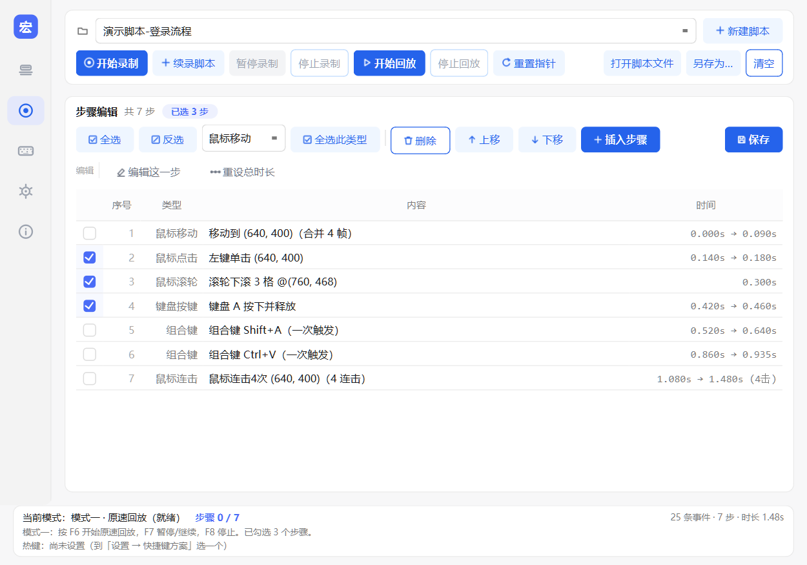
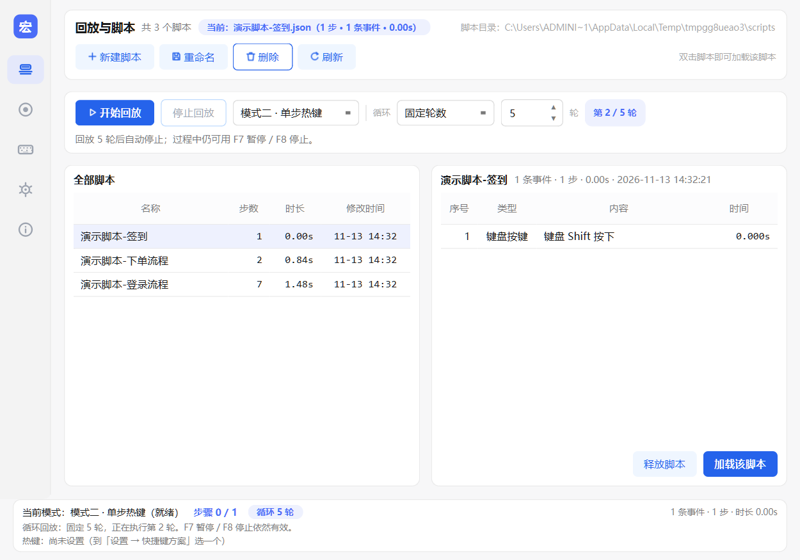
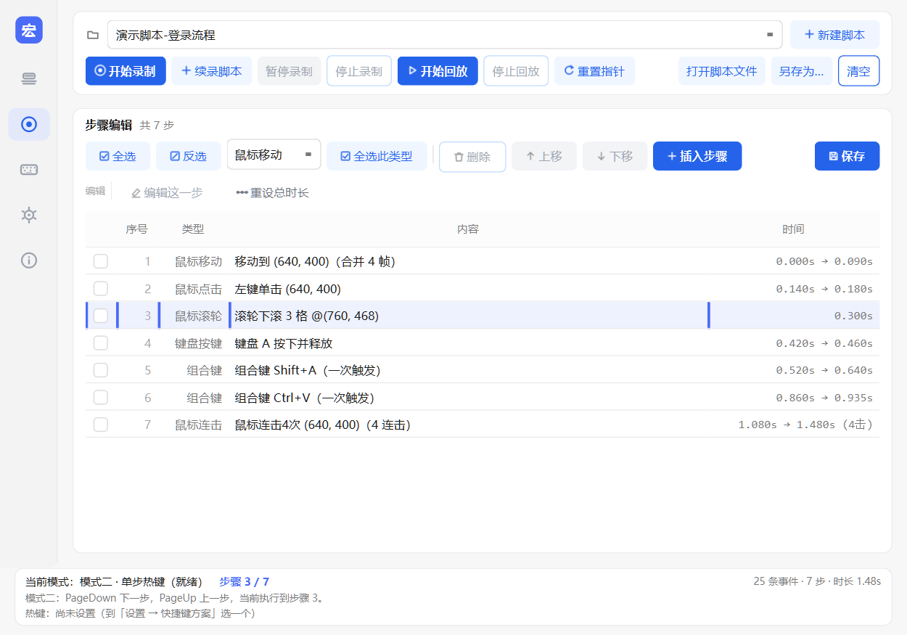
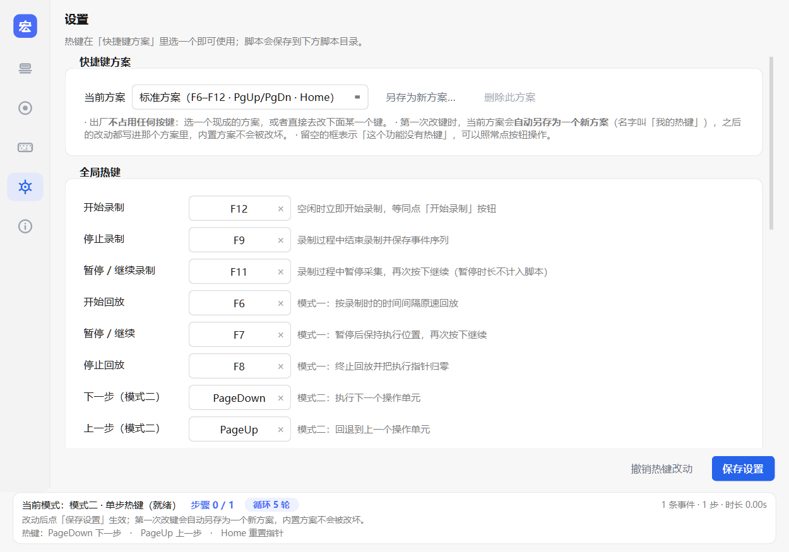

# MacroSmith 宏匠

**Windows 桌面键鼠自动化工具** —— 录制鼠标与键盘操作，随时原速回放，也可以逐单步手动驱动。

类按键精灵，但更轻：一个原生窗口、无后台服务、脚本就是可读的 JSON。


---

## 界面预览

| 录制与步骤编辑 | 回放与脚本 |
| :---: | :---: |
|  |  |

| 单步执行 | 设置 |
| :---: | :---: |
|  |  |

---

## 功能特性

### 录制

- 记录鼠标移动、左/右/中键点击、滚轮（含水平滚动）、键盘按键
- 毫秒级时间戳，基于单调时钟计时，不受系统时间调整影响
- 移动抖动自动过滤；同坐标的冗余移动帧自动剔除
- **开始录制热键（F12）**：软件在后台也能直接开录，等同点「开始录制」；录制中或回放中按下只会提示，不会打断当前流程
- 开始 / 停止录制热键（F12 / F9）不会被录进脚本
- **暂停 / 继续录制（F11）**：录制中可随时暂停，暂停期间的输入不会记入脚本；继续后时间戳无缝衔接，暂停时长像凭空消失一样
- **续录脚本（追加录制）**：在已有脚本末尾接着录，原有步骤一条不动；接缝处自动留 0.5 秒间隔，回放不突兀。列表为空时该按钮自动禁用
- 录制结束自动补齐「按下未释放」的按键，回放不卡键
- **腾讯系平台兼容**：前台是 WeGame / QQ 游戏大厅等平台时，自动切换到轮询采集通道（其反作弊驱动会过滤常规键鼠钩子），离开后自动切回，无需手动设置
- **需要管理员权限**：上述平台的进程完整性级别较高，普通权限下只能录到鼠标移动、录不到点击与键盘。`start.bat` 会自动申请提权，安装版 exe 自带管理员清单（双击后确认 UAC 即可）

### 步骤编辑器

- 录制结果以**步骤列表**呈现，可勾选、删除、上移/下移、插入新步骤
- **批量勾选**：工具栏「全选此类型」可按类型（移动/点击/滚轮/键盘/组合键/连击）一次勾完；也可以直接在列表里**按住左键框选**，拖过的行会高亮并同步勾上复选框
- 每一步都可二次编辑：
  - 鼠标：动作（单击/双击/三击/任意连击、左/右/中键）与坐标分离修改，支持屏幕取点
  - 键盘：直接按键改键；组合键可勾选修饰键 + 目标键
  - 移动：目标坐标、持续时长（秒），插入的移动自动补中间帧，回放平滑
  - 滚轮：滚动量与坐标（带屏幕取点）
- 时间单位统一为秒，单步时间与整段总时长均可重排
- **步间间隔可编辑**：单步编辑里可单独调整「与上一步 / 与下一步」的空白间隔，后续时间戳自动顺延，不会重叠或出现负数
- **重设总时长**支持目标时长 + 平均步间间隔 + 间隔随机浮动（± 秒），节奏更接近真人操作
- 编辑后时间戳自动重排，保存即写回 JSON

### 快捷键方案（出厂不占用任何按键）

- **出厂一个热键都不绑**：F1–F12 在别的软件里各有用途，装完就抢键会被当成「键盘坏了」
- 「设置 → 快捷键方案」下拉里挑一个现成的——随软件附带**标准方案**
  （`F6`–`F12` + `PageUp/PageDown/Home`，就是老版本那组键）
- 也可以直接去改某一个功能：**第一次改键会自动另存为一个新方案**
  （默认叫「我的热键」，重名自动加序号），之后的改动都写在这个方案里，内置方案不会被改坏
- 方案文件是普通 JSON，放在配置目录旁边的 `hotkey_sets/` 文件夹，可以拷给别人用：

  ```json
  {"name": "我的热键", "hotkeys": {"record_stop": "f9", "play_toggle": "f6"}}
  ```

- 留空 = 这个功能没有热键，照常点按钮即可；下拉选「不使用方案」= 全部释放
- **清空某个键**：点输入框右侧的 `×`（常驻显示，空值时置灰不可点）。`Esc` 只是退出
  录入状态，不会把已设的键弄丢——这是两件事，别混
- **冲突即时提示**：两个功能绑了同一个键，两个框当场一起变红，状态栏点名「F9 同时绑给了
  『停止录制』、『停止回放』」；点保存时还会再拦一道，不让存进去
- **侧边栏提示语跟着当前绑定走**：悬停显示「功能说明 + 当前按键」，
  一个键都没绑时明确写「未设置」，不会出现「提示里写着 F9、实际你改成了 F10」

### 快捷输入（文本模拟打字）

- 按热键把文本**逐字符敲**进当前焦点窗口：一条敲剪贴板，另外三条各敲一个快捷密码
- 四条热键**都可以自己改**（剪贴板那条也不固定 `F1`），留空则该条不占键
- 不走剪贴板粘贴，密码框 / 远程桌面 / 禁止粘贴的输入框都能收到；也不占用你的剪贴板
- 不会粘贴、不会被输入法改写：字符直接进消息队列，中文输入法开着也不会把 `b`
  拼成「杯」，CapsLock 也不会翻大小写
- 遇到拦截模拟键盘的程序（游戏大厅、安全控件）：先在快捷输入页换「输入通道」再试
  （物理按键 / 仅扫描码 / 窗口消息），状态栏会说明这次走的是哪条路
- 只支持 ASCII（英文、数字、半角符号）；中文/全角/Emoji 会被丢弃并在状态栏报数
- 密码用 DPAPI + 附加熵加密保存：只有宏匠能解出明文，别的程序（哪怕是同一个
  Windows 用户下运行）都解不开；录制期间整组功能自动失效
- 默认关闭。首次使用到侧边栏第三项「快捷输入」页手动勾选「启用快捷输入」，
  勾上即刻生效并写入配置，之后每次启动都保持启用

### 智能合并

- `Ctrl+V`、`Ctrl+Shift+S` 等组合键自动归并为一步
- 同坐标快速连续点击自动合并为「双击 / 三击 / 连击 N 次」，次数不设上限
- 连击可随时勾选「拆分为独立单击」还原，拆分结果不会被重新粘回去
- 合并只在载入时计算，JSON 中始终保存原始事件流，完全可逆

### 两种回放模式

| 模式 | 驱动方式 | 时间戳 | 适用场景 |
| :--- | :--- | :--- | :--- |
| **模式一 · 原速回放** | 一键全自动 | 严格按录制节奏 | 流程自动化、挂机重复操作 |
| **模式二 · 单步执行** | 每按一次热键执行一步 | 忽略时间戳 | 分步调试、教学演示、半自动操作 |

模式一支持**不循环 / 固定轮数 / 无限循环**，状态栏实时显示当前轮次。

**两种模式可以中途接力**，不用手动数到第几步：

- 原速回放跑了几步想改单步看看？暂停后直接按 `PageDown`，**从暂停处往下走**，不会退回第一步。暂停点落在某一步中间时，这一步算没跑完，从它的开头重跑（一个步骤要么完整执行，要么不执行，不会有「只按下没释放」的半截动作）
- 单步调试跑了几步想整段放完？直接按 `F6`，**从下一步接着放**
- 主动按 `F8` 停止 = 指针归零，下次从头开始；自然播完同理；单步走到最后一步再按 `F6`，从头再放一轮
- 状态栏会提示「已从回放切到单步：接着第 N 步开始（前面 N-1 步已经跑过）」，切模式时不响「回放结束」提示音

- **移动走真实输入栈**：鼠标移动通过 Win32 `SendInput` 投递（不是直接改光标位置），
  Windows 11 记事本、资源管理器这类 WinUI 应用的菜单栏悬停、子菜单展开与真人操作一致
- **落定延时**：末帧移动与「按下」之间自动补足 50ms，菜单亮起后再点击，不会点空

### 全局热键与独占模式

- 所有控制热键全局生效；出厂不绑键，进「设置 → 快捷键方案」选一个（或逐个自定义）
- 热键独占（默认开启）：通过 Win32 低级键盘钩子拦截热键，按键不会同时触发浏览器等前台程序；钩子安装失败自动降级为普通监听
- 程序自身注入的模拟事件不会被二次录制

### 快捷输入：注入通道与密码加密

在侧边栏第三项**「快捷输入」页**里可以给自己配一组**打字热键**：按下就把一段文本
逐字符「敲」进当前有焦点的输入框。**默认关闭**，需要手动勾选「启用快捷输入」——
勾上就已经生效并落盘，之后一直保持启用，不依赖页面底部的「保存」按钮。

| 位置 | 作用 |
| :--- | :--- |
| 剪贴板 | 敲入剪贴板里的文本（可改键，勾掉复选框则该条不注册） |
| 密码 1 / 2 / 3 | 敲入三个快捷密码（可改键；密码留空则不占用该键） |

四条热键**全部可改**，没有哪一条被写死；键位来自「设置 → 快捷键方案」里选中的那个方案。

- **不走剪贴板**：逐字符 `SendInput`，对目标程序来说与真人敲键盘无异，密码框、
  远程桌面、禁止粘贴的输入框都能收到；也不会覆盖你剪贴板里原有的内容
- **游戏/安全控件也能进**：这类程序对模拟输入很挑剔。宏匠在动手前先用左 `Shift`
  探一次路（按下后读键状态 + 系统输入时间戳，两条判据有一条动就算通），确认事件
  真的进了系统才开始敲；默认就走**物理按键**（键码与扫描码都填准，和真键盘发出的
  东西一模一样），进不去再依次改走**仅扫描码**和**窗口消息**（`WM_CHAR`，不经过
  输入栈）。设置页有「输入通道」下拉，自动不行就手工换一条；状态栏会注明这次走
  的是哪条路
  - 探针**不许再用 `F24`**：那个键是自动化工具的招牌，部分安全驱动会专门过滤它，
    于是探针读不到按下、程序误判「注入被拦」而跳过所有真实注入。这类失败是静默的
    （不报错、只走错分支），有专门的单测锁着这条规则
- **QQ 游戏大厅的密码框只认扫描码**：2026-11-12 的对照实验证明（`tools/try_type.py`），
  它**拒收 `KEYEVENTF_UNICODE`（`wVk=0`）的事件，却收任何带真扫描码的按键**。
  参考工具的抓包也是这个形态。所以默认通道是物理按键，不是字符注入
- **字符通道仍可手工指定**：`KEYEVENTF_UNICODE` 把字符直接塞进消息队列，不受
  输入法、`CapsLock`、键盘布局影响（中文输入法开着也不会把 `b` 拼成「杯」）。
  普通程序里它最稳，但受保护控件不认，所以只作为可选项
- **物理按键通道受 `CapsLock` 影响**：它按的是「真键」，大小写跟着系统状态走。
  密码里有大写字母时，敲之前确认 `CapsLock` 是关的（否则 `A` 会变成 `a`）
- **只打 ASCII**：中文、全角标点、Emoji 会被直接丢弃，状态栏会告诉你
  「已丢弃 N 个非 ASCII 字符」。密码、验证码、邮箱、URL 都在这个范围内
  （通道本身能打中文，是本功能刻意限定在 ASCII）
- **密码加密保存，只有宏匠能解**：用 Windows DPAPI 加密，并带一串**只有本程序知道
  的附加熵**（`MacroSmith/quick_input/v2`）参与密钥派生。同一个 Windows 用户下，
  别的程序就算调用 `CryptUnprotectData` 也只会得到失败——配置文件可以被拷走，
  但里面的密码读不出来。配置文件拷到别的电脑 / 别的 Windows 账户同样解不开，
  需要重新填写。旧版本留下的无熵密文（`enc1:`）会在启动时自动重加密为 `enc2:`
- **录制期间自动失效**：热键与敲出的字符都不会进入脚本；总开关关着时这些键
  仍是普通按键，可以照常录进脚本
- 每次触发的状态栏提示会报「已敲入 N 个字符」，敲完为止不必盯着屏幕

### 其他

- **任务栏状态徽标**：任务栏按钮右下角实时显示当前状态——录制中＝红点、录制暂停＝琥珀双竖条、回放中＝绿三角、回放暂停＝暗绿双竖条，空闲时不叠徽标。窗口最小化或被别的程序挡住也能一眼看出「是不是还在录 / 还在放」，**窗口标题始终是「宏匠」**
- **状态提示音**：开始 / 暂停 / 继续 / 结束 录制与回放各响一声——录制用低音区、回放用高音区，上行＝开始、下行＝暂停、单声＝继续、三连降＝结束，不看屏幕也分得清在录还是在放。模式二「上一步 / 下一步」另有极短的按键音（下一步高、上一步低）；停止录制不发声。设置页「录制与回放 → 状态提示音」是总开关，「单步上下步也发提示音」可单独关掉
- Per-Monitor DPI 感知，高分屏下录制与回放坐标一致
- 窗口尺寸、位置、所有设置自动持久化
- 未保存改动有切换/覆盖保护，并在状态栏高亮「未保存」；关闭窗口可选「保存并退出 / 直接退出 / 取消」
- 「释放脚本」一键清空当前加载内容；未加载脚本时回放热键不响应
- 脚本选择为纯下拉框，「打开脚本文件」直接打开脚本所在文件夹
- 空脚本点「开始录制」不会误弹覆盖提示；默认名（`录制-…`）保存时静默覆盖，不再弹确认框
- 所有确认弹窗按钮均为中文（确定 / 取消 / 保存 / 不保存），无英文 Yes/No
- 单实例运行，不会同时启动两个

---

## 快速开始

### 方式一：安装包（推荐普通用户）

1. 从 [Releases](../../releases) 下载 `MacroSmith-Setup-<版本>.exe`
2. 双击安装，开始菜单和桌面快捷方式可选
3. 启动「宏匠」即可使用；卸载会保留你的脚本与配置

### 方式二：源码运行

环境要求：Windows 10/11、Python 3.11+

```powershell
python -m pip install -r requirements.txt
python main.py
```

其他启动参数：

```powershell
python main.py --check                                 # 启动自检（不开界面）
python main.py --script "C:\path\to\script.json"       # 启动即载入脚本
```

---

## 使用流程

```
录制（F12 开始 / F11 暂停 / F9 停止） → 步骤编辑（可选） → 保存脚本 → 回放
                                         ├─ F6 原速回放（F7 暂停 / F8 停止）
                                         └─ PageDown 单步执行（PageUp 回退 / Home 重置）
```

> 两种模式随时可切：回放暂停后按 `PageDown` 从暂停处接着单步；单步几步后按 `F6`
> 从下一步接着原速播放。执行指针由程序在两个模式间自动换算。

### 热键从哪来

**出厂不绑定任何热键。** 到「设置 → 快捷键方案」选一个即可（或自己改某个键）：

| 标准方案（选中后生效） | 功能 |
| :--- | :--- |
| `F12` | 开始录制（空闲时生效） |
| `F9` | 停止录制 |
| `F11` | 暂停 / 继续录制 |
| `F6` | 开始原速回放 |
| `F7` | 暂停 / 继续 |
| `F8` | 停止回放 |
| `PageDown` | 单步模式：执行下一步 |
| `PageUp` | 单步模式：回退一步 |
| `Home` | 单步模式：重置到开头 |

快捷输入那四条（敲剪贴板 + 三个密码）也在标准方案里，是 `F1`–`F4`，
但**都可以改**，见「快捷输入」页。

上面这 9 个在「设置 → 全局热键」里逐个改；快捷输入那 4 个在「快捷输入」页里改。

---

## 数据与配置

| 内容 | 安装版路径 | 源码运行路径 |
| :--- | :--- | :--- |
| 配置 | `%APPDATA%\MacroSmith\config.json` | 项目目录 `config.json` |
| 脚本 | `%APPDATA%\MacroSmith\scripts\` | `data\scripts\` |
| 日志 | `%APPDATA%\MacroSmith\logs\` | `%APPDATA%\MacroSmith\logs\` |

脚本为纯 JSON，一条事件包含类型、毫秒时间戳与坐标 / 按键信息，可直接阅读、手写或用外部程序生成：

```json
{
  "app": "MacroSmith",
  "version": 1,
  "name": "示例脚本",
  "duration_ms": 700,
  "events": [
    {"t": 0,   "type": "mouse_move",  "x": 100, "y": 100},
    {"t": 260, "type": "mouse_click", "action": "press",   "button": "left", "x": 300, "y": 400},
    {"t": 300, "type": "mouse_click", "action": "release", "button": "left", "x": 300, "y": 400},
    {"t": 700, "type": "key", "action": "press", "key": "vk:65", "vk": 65}
  ]
}
```

按键统一使用虚拟键码（`vk:<code>`），回放不受输入法与大小写影响。

---

## 项目结构

```
MacroSmith/
├── main.py               # 程序入口（DPI、单实例、图标、自检）
├── requirements.txt
├── assets/               # 应用图标
├── core/                 # 核心逻辑（无 Qt 依赖，可被 CLI 复用）
│   ├── recorder.py       # 录制（监听、抖动过滤）
│   ├── player.py         # 回放（原速 / 单步 / 循环 / 坐标钳制）
│   ├── event_parser.py   # 事件分组、JSON 读写、智能合并、时间戳重排
│   ├── config.py         # 配置持久化
│   ├── hotkey_manager.py # 全局热键
│   ├── hotkey_sets.py    # 快捷键方案（内置标准方案 + 用户方案文件读写）
│   ├── hotkey_hook.py    # Win32 低级键盘钩子（热键独占）
│   ├── win_input.py      # SendInput 注入（鼠标 / 字符 / 扫描码 / 物理按键 / 原生入口）
│   ├── direct_input.py   # 窗口消息注入（WM_CHAR，给反注入的游戏/安全控件用）
│   ├── quick_input.py    # 快捷输入：ASCII 过滤、三级通道降级、密码加密（DPAPI + 附加熵）
│   └── sound.py          # 状态提示音（标准库 wave 合成）
├── ui/                   # PySide6 界面
│   ├── main_window.py    # 主窗口、页面栈、状态机、热键分发
│   ├── sidebar.py        # 侧边栏（脚本库 / 录制 / 快捷输入 / 设置 / 关于）
│   ├── quick_page.py     # 快捷输入页（总开关 / 通道 / 三个密码槽）
│   └── settings.py       # 设置页（全局热键、回放、录制、界面）
├── utils/                # Windows 系统工具（DPI、单实例、图标）
├── tests/                # 自动化测试
├── tools/                # CLI 工具与自检脚本
├── docs/                 # 界面截图
└── installer/            # Inno Setup 安装包脚本
```

核心逻辑与界面完全解耦：`core/` 不依赖 Qt，录制 / 回放均可通过 `tools/` 下的命令行工具独立调用。

---

## 技术栈

- [PySide6](https://www.qt.io/qt-for-python) —— 界面框架
- [pynput](https://github.com/moses-palmer/pynput) —— 键鼠监听与模拟
- ctypes / Win32 API —— 低级键盘钩子、DPI 感知、单实例互斥
- [Nuitka](https://nuitka.net/) + [Inno Setup](https://jrsoftware.org/isinfo.php) —— 打包（机器码，无 `.py` / `.pyc`）与安装程序

---

## 自行打包

```powershell
# 1) Nuitka 编译（需 Python 3.13 + Nuitka 4.2.1 + PySide6 6.8.x，版本见 requirements.txt）
.\build_nuitka.bat

# 2) （需自行安装 Inno Setup 6）编译安装包
& "C:\Program Files (x86)\Inno Setup 6\ISCC.exe" installer\MacroSmith.iss
```

Nuitka 产物在 `build_nuitka\main.dist\`，需对齐到 `dist\MacroSmith\`（安装脚本按此路径读取），安装包输出到 `installer\Output\`。

> 版本锁定不要随意升级：Nuitka 4.3.x / PySide6 6.11.x 存在 Qt 子类创建段错误的回归问题。
> 打包产物自带管理员清单（`--windows-uac-admin`），双击即申请提权。

安装包输出到 `installer\Output\`。打包后配置与脚本自动切换到 `%APPDATA%\MacroSmith\`，发布包不含任何用户脚本。

---

## 已知限制

- **腾讯系游戏的游戏本体不受支持**：大厅 / 登录器界面可以正常录制（需管理员权限），但进入受反作弊保护的游戏本体后，键鼠注入会被内核驱动过滤，回放可能无效，也可能被判定为异常操作，请自行评估风险
- **受保护窗口内录不到滚轮**：滚轮没有可轮询的状态接口，兼容通道只覆盖移动、点击与键盘
- **按住型操作依赖管理员权限**：普通权限下对高完整性级别窗口只能录到鼠标移动
- **快捷输入只支持 ASCII**：通道本身能打中文（`KEYEVENTF_UNICODE` / `WM_CHAR`），
  是本功能刻意限定在 ASCII——密码/验证码/邮箱/URL 都在这个范围内。需要输入
  中文请用系统输入法
- **少数自绘界面所有通道都不吃**：宏匠会依次试字符注入、物理按键、仅扫描码，
  最后改用窗口消息；都不行时状态栏会明说（不会假装成功）。这类界面通常还需要
  **以管理员身份运行宏匠**（目标权限更高时，注入与消息都会被系统丢掉）。
  真遇到打不进去的，三个诊断脚本各管一件事，**别拿错**：

  | 脚本 | 干什么 | 看什么 |
  |---|---|---|
  | `tools\run_probe.bat` | 只读诊断：目标类名、双方权限、四条通道各能否写入 | 控制台结论，或 `tools\captures\probe_*.log` |
  | `tools\watch_input.bat` | 抓按键事件流：钩子 + `GetLastInputInfo` 双路 | 屏幕上逐条的 `vk/scan/[INJECTED]`，或 `tools\captures\watch_*.log` |
  | `tools\start_debug.bat` | 用**调试级日志**启动宏匠（等同 `python main.py --debug`） | `%APPDATA%\MacroSmith\logs\macrosmith.log` 里逐键的「钩子收到按键」与「热键动作」 |

  **热键按了没反应，先用第三个**：它会记下钩子看到的每一个按键。日志里连
  `钩子收到按键 vk=0x71（F2）` 都没有，说明那个键根本没到宏匠的钩子（被上游的
  安全输入组件或驱动吃掉了）；有这一行却没有后面的 `热键动作` / `快捷输入目标`，
  问题才在绑定或注入环节。平时别开——正常打字一分钟就能刷几百行。

  前两个都会自己请求管理员权限：**提权写在 Python 里**（`ShellExecuteW runas`），
  批处理只负责挑解释器。批处理做提权踩过坑——`Start-Process -Verb RunAs` 拉起新
  窗口后父窗口立刻退出，UAC 弹窗没被注意到时看到的就是「窗口闪一下就没了」，
  连句提示都没有。`run_probe` 有 8 秒倒计时，**要在这段时间内切到目标窗口、把光标
  点进输入框**，否则测到的是终端自己。`watch_input` **一次只测一个工具**（启动后
  会问 `1` 参考工具 / `2` 宏匠），因为换工具必然要动鼠标，而鼠标动作也会让
  `GetLastInputInfo` 跳，混在一起就分不清是谁的信号了。
- **敲之前先点一下**：按下热键后，宏匠会先在**当前指针位置**补一次左键单击，
  再开始敲字。QQ、腾讯微云、WeGame 这类登录框是页面内输入框，只有收到真实的
  鼠标按下才把键盘焦点交给那个框——不点的话字会被丢掉，而 `SendInput` 还照样
  返回成功。所以**指针要放在要输入的框上**（参考工具也是这个规矩）；在普通
  输入框里嫌麻烦，可以到「快捷输入 → 敲击细节」把它取消勾选
- **热键能穿过「输入中转」**：有些安全输入组件（QQ 登录框那类）会把真人按键
  **重新注入**再往下传，事件看起来像「软件模拟的」。宏匠认的是自己注入时写的
  `dwExtraInfo` 标记，而不是「是不是注入事件」，所以这种中转不影响热键。
  **两个注入标志位都不能用来判断是谁敲的**：中转后的真人按键既可能带
  `INJECTED`，也可能带 `LOWER_IL_INJECTED`（宏匠是管理员、QQ 是普通权限时
  就是后者）——2026-11-12 在这上面栽过两次，现在只认标记。
  代价是别的脚本工具注入的按键也会被当成真人按键
- **「快捷输入 → 敲击细节 → 输入通道」**可以直接切换注入方式（默认「自动」）；钉死某一条
  通道会跳过自动降级，只建议排障时用。`config.json` 里的 `quick_input.mode` 是同一个
  值（`auto` / `unicode` / `physical` / `simulate` / `message` / `vk`）

---

## 许可证与版权声明

本项目采用 PolyForm Noncommercial License 1.0.0 授权。

- **个人使用**：允许个人出于非商业目的免费使用本软件。
- **修改与分发**：允许在遵守许可证条款的前提下修改、复制和免费分发本软件及其修改版本。
- **署名要求**：转载或分发本项目及其修改版本时，必须保留原有版权声明、许可证文本及相关署名信息。修改版本应明确说明修改内容，且不得使他人误认为修改版本由原作者官方发布。
- **商业用途**：未经版权持有人单独书面授权，不得将本软件或其衍生版本用于商业目的，包括商业分发、收费销售等。
- **商业授权**：版权持有人保留本软件的商业使用、商业授权及后续商业化开发权利。如需商业授权，请联系版权持有人。

完整授权条款以项目根目录中的 LICENSE 文件为准。

版权所有 © 2026 Shuaihuai9
