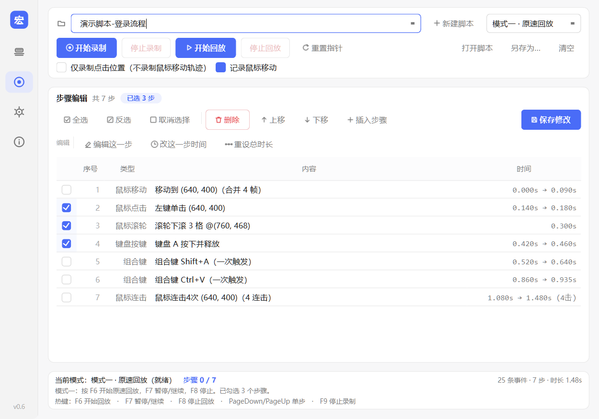
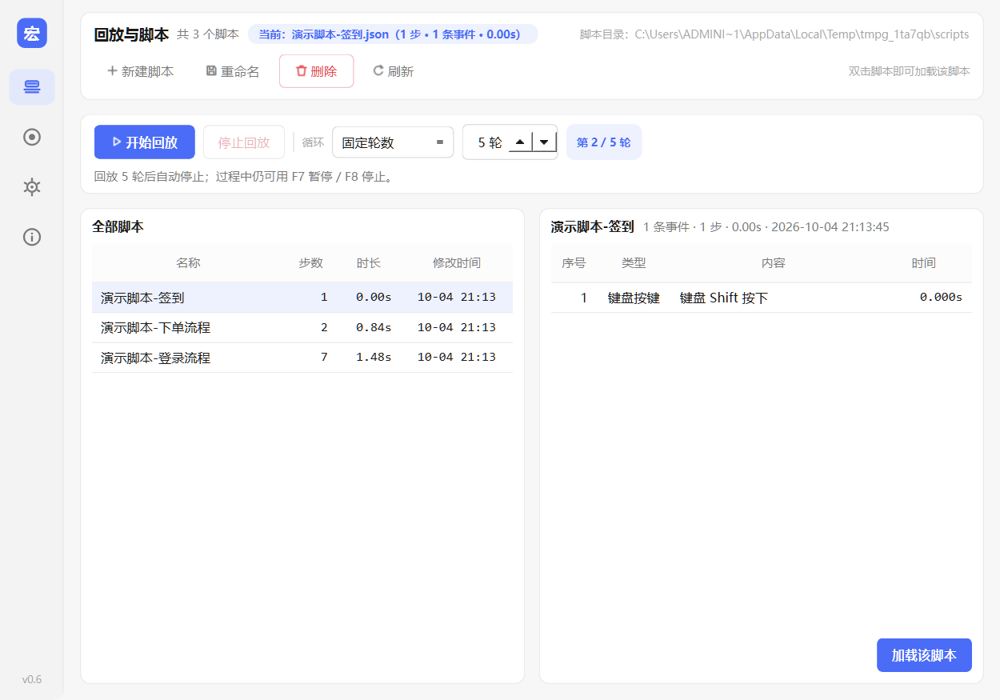
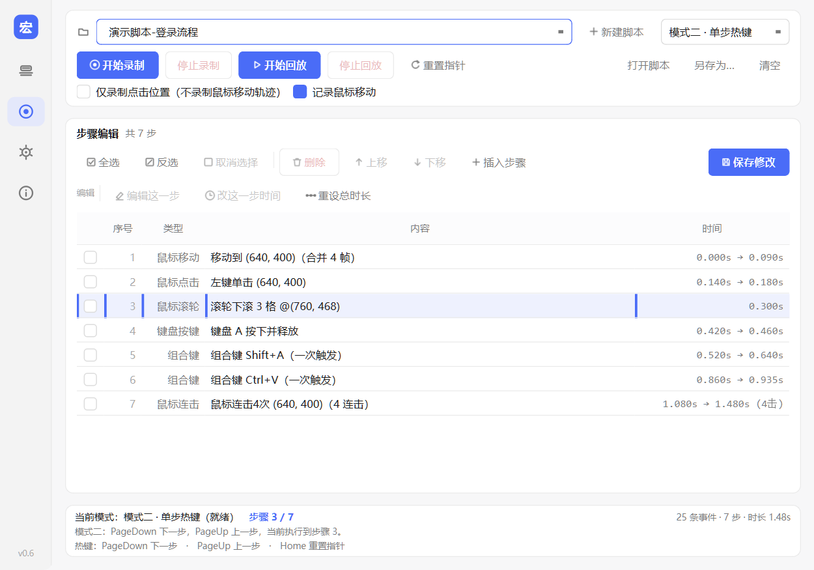
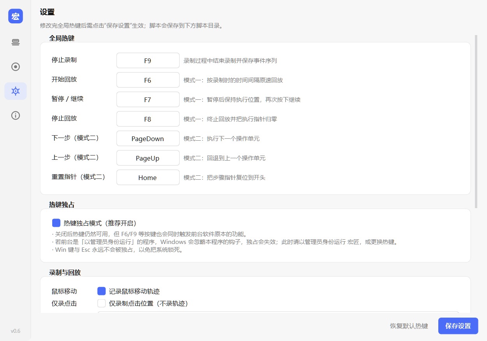

# MacroSmith 宏匠

**Windows 桌面键鼠自动化工具** —— 录制鼠标与键盘操作，随时原速回放，也可以逐单步手动驱动。

类按键精灵，但更轻：一个原生窗口、无后台服务、脚本就是可读的 JSON。


---

## 界面预览

| 录制与步骤编辑 | 回放与脚本 |
| :---: | :---: |
|  |  |

| 单步执行 | 设置 |
| :---: | :---: |
|  |  |

---

## 功能特性

### 录制

- 记录鼠标移动、左/右/中键点击、滚轮（含水平滚动）、键盘按键
- 毫秒级时间戳，基于单调时钟计时，不受系统时间调整影响
- 移动抖动自动过滤；同坐标的冗余移动帧自动剔除
- 停止录制热键（F9）不会被录进脚本
- 录制结束自动补齐「按下未释放」的按键，回放不卡键
- **腾讯系平台兼容**：前台是 WeGame / QQ 游戏大厅等平台时，自动切换到轮询采集通道（其反作弊驱动会过滤常规键鼠钩子），离开后自动切回，无需手动设置
- **需要管理员权限**：上述平台的进程完整性级别较高，普通权限下只能录到鼠标移动、录不到点击与键盘。`start.bat` 会自动申请提权，安装版 exe 自带管理员清单（双击后确认 UAC 即可）

### 步骤编辑器

- 录制结果以**步骤列表**呈现，可勾选、删除、上移/下移、插入新步骤
- 每一步都可二次编辑：
  - 鼠标：动作（单击/双击/三击/任意连击、左/右/中键）与坐标分离修改，支持屏幕取点
  - 键盘：直接按键改键；组合键可勾选修饰键 + 目标键
  - 移动：目标坐标、持续时长（秒），插入的移动自动补中间帧，回放平滑
  - 滚轮：滚动量与坐标（带屏幕取点）
- 时间单位统一为秒，单步时间与整段总时长均可重排
- **步间间隔可编辑**：单步编辑里可单独调整「与上一步 / 与下一步」的空白间隔，后续时间戳自动顺延，不会重叠或出现负数
- **重设总时长**支持目标时长 + 平均步间间隔 + 间隔随机浮动（± 秒），节奏更接近真人操作
- 编辑后时间戳自动重排，保存即写回 JSON

### 智能合并

- `Ctrl+V`、`Ctrl+Shift+S` 等组合键自动归并为一步
- 同坐标快速连续点击自动合并为「双击 / 三击 / 连击 N 次」，次数不设上限
- 连击可随时勾选「拆分为独立单击」还原，拆分结果不会被重新粘回去
- 合并只在载入时计算，JSON 中始终保存原始事件流，完全可逆

### 两种回放模式

| 模式 | 驱动方式 | 时间戳 | 适用场景 |
| :--- | :--- | :--- | :--- |
| **模式一 · 原速回放** | 一键全自动 | 严格按录制节奏 | 流程自动化、挂机重复操作 |
| **模式二 · 单步执行** | 每按一次热键执行一步 | 忽略时间戳 | 分步调试、教学演示、半自动操作 |

模式一支持**不循环 / 固定轮数 / 无限循环**，状态栏实时显示当前轮次。

### 全局热键与独占模式

- 所有控制热键全局生效，可在设置页自定义
- 热键独占（默认开启）：通过 Win32 低级键盘钩子拦截热键，按键不会同时触发浏览器等前台程序；钩子安装失败自动降级为普通监听
- 程序自身注入的模拟事件不会被二次录制

### 其他

- Per-Monitor DPI 感知，高分屏下录制与回放坐标一致
- 窗口尺寸、位置、所有设置自动持久化
- 未保存改动有切换/覆盖保护，并在状态栏高亮「未保存」；关闭窗口可选「保存并退出 / 直接退出 / 取消」
- 「释放脚本」一键清空当前加载内容；未加载脚本时回放热键不响应
- 脚本选择为纯下拉框，「打开脚本文件」直接打开脚本所在文件夹
- 单实例运行，不会同时启动两个

---

## 快速开始

### 方式一：安装包（推荐普通用户）

1. 从 [Releases](../../releases) 下载 `MacroSmith-Setup-<版本>.exe`
2. 双击安装，开始菜单和桌面快捷方式可选
3. 启动「宏匠」即可使用；卸载会保留你的脚本与配置

### 方式二：源码运行

环境要求：Windows 10/11、Python 3.11+

```powershell
python -m pip install -r requirements.txt
python main.py
```

其他启动参数：

```powershell
python main.py --check                                 # 启动自检（不开界面）
python main.py --script "C:\path\to\script.json"       # 启动即载入脚本
```

---

## 使用流程

```
录制（F9 停止） → 步骤编辑（可选） → 保存脚本 → 回放
                                         ├─ F6 原速回放（F7 暂停 / F8 停止）
                                         └─ PageDown 单步执行（PageUp 回退 / Home 重置）
```

### 默认热键

| 热键 | 功能 |
| :--- | :--- |
| `F9` | 停止录制 |
| `F6` | 开始原速回放 |
| `F7` | 暂停 / 继续 |
| `F8` | 停止回放 |
| `PageDown` | 单步模式：执行下一步 |
| `PageUp` | 单步模式：回退一步 |
| `Home` | 单步模式：重置到开头 |

所有热键均可在「设置 → 全局热键」中修改。

---

## 数据与配置

| 内容 | 安装版路径 | 源码运行路径 |
| :--- | :--- | :--- |
| 配置 | `%APPDATA%\MacroSmith\config.json` | 项目目录 `config.json` |
| 脚本 | `%APPDATA%\MacroSmith\scripts\` | `data\scripts\` |
| 日志 | `%APPDATA%\MacroSmith\logs\` | `%APPDATA%\MacroSmith\logs\` |

脚本为纯 JSON，一条事件包含类型、毫秒时间戳与坐标 / 按键信息，可直接阅读、手写或用外部程序生成：

```json
{
  "app": "MacroSmith",
  "version": 1,
  "name": "示例脚本",
  "duration_ms": 700,
  "events": [
    {"t": 0,   "type": "mouse_move",  "x": 100, "y": 100},
    {"t": 260, "type": "mouse_click", "action": "press",   "button": "left", "x": 300, "y": 400},
    {"t": 300, "type": "mouse_click", "action": "release", "button": "left", "x": 300, "y": 400},
    {"t": 700, "type": "key", "action": "press", "key": "vk:65", "vk": 65}
  ]
}
```

按键统一使用虚拟键码（`vk:<code>`），回放不受输入法与大小写影响。

---

## 项目结构

```
MacroSmith/
├── main.py               # 程序入口（DPI、单实例、图标、自检）
├── requirements.txt
├── assets/               # 应用图标
├── core/                 # 核心逻辑（无 Qt 依赖，可被 CLI 复用）
│   ├── recorder.py       # 录制（监听、抖动过滤）
│   ├── player.py         # 回放（原速 / 单步 / 循环 / 坐标钳制）
│   ├── event_parser.py   # 事件分组、JSON 读写、智能合并、时间戳重排
│   ├── config.py         # 配置持久化
│   ├── hotkey_manager.py # 全局热键
│   └── hotkey_hook.py    # Win32 低级键盘钩子（热键独占）
├── ui/                   # PySide6 界面
├── utils/                # Windows 系统工具（DPI、单实例、图标）
├── tests/                # 自动化测试
├── tools/                # CLI 工具与自检脚本
├── docs/                 # 界面截图
└── installer/            # Inno Setup 安装包脚本
```

核心逻辑与界面完全解耦：`core/` 不依赖 Qt，录制 / 回放均可通过 `tools/` 下的命令行工具独立调用。

---

## 技术栈

- [PySide6](https://www.qt.io/qt-for-python) —— 界面框架
- [pynput](https://github.com/moses-palmer/pynput) —— 键鼠监听与模拟
- ctypes / Win32 API —— 低级键盘钩子、DPI 感知、单实例互斥
- [Nuitka](https://nuitka.net/) + [Inno Setup](https://jrsoftware.org/isinfo.php) —— 打包（机器码，无 `.py` / `.pyc`）与安装程序

---

## 自行打包

```powershell
# 1) Nuitka 编译（需 Python 3.13 + Nuitka 4.2.1 + PySide6 6.8.x，版本见 requirements.txt）
.\build_nuitka.bat

# 2) （需自行安装 Inno Setup 6）编译安装包
& "C:\Program Files (x86)\Inno Setup 6\ISCC.exe" installer\MacroSmith.iss
```

Nuitka 产物在 `build_nuitka\main.dist\`，需对齐到 `dist\MacroSmith\`（安装脚本按此路径读取），安装包输出到 `installer\Output\`。

> 版本锁定不要随意升级：Nuitka 4.3.x / PySide6 6.11.x 存在 Qt 子类创建段错误的回归问题。
> 打包产物自带管理员清单（`--windows-uac-admin`），双击即申请提权。

安装包输出到 `installer\Output\`。打包后配置与脚本自动切换到 `%APPDATA%\MacroSmith\`，发布包不含任何用户脚本。

---

## 已知限制

- **腾讯系游戏的游戏本体不受支持**：大厅 / 登录器界面可以正常录制（需管理员权限），但进入受反作弊保护的游戏本体后，键鼠注入会被内核驱动过滤，回放可能无效，也可能被判定为异常操作，请自行评估风险
- **受保护窗口内录不到滚轮**：滚轮没有可轮询的状态接口，兼容通道只覆盖移动、点击与键盘
- **按住型操作依赖管理员权限**：普通权限下对高完整性级别窗口只能录到鼠标移动

---

## 许可证与版权声明

本项目采用 PolyForm Noncommercial License 1.0.0 授权。

- **个人使用**：允许个人出于非商业目的免费使用本软件。
- **修改与分发**：允许在遵守许可证条款的前提下修改、复制和免费分发本软件及其修改版本。
- **署名要求**：转载或分发本项目及其修改版本时，必须保留原有版权声明、许可证文本及相关署名信息。修改版本应明确说明修改内容，且不得使他人误认为修改版本由原作者官方发布。
- **商业用途**：未经版权持有人单独书面授权，不得将本软件或其衍生版本用于商业目的，包括商业分发、收费销售等。
- **商业授权**：版权持有人保留本软件的商业使用、商业授权及后续商业化开发权利。如需商业授权，请联系版权持有人。

完整授权条款以项目根目录中的 LICENSE 文件为准。

版权所有 © 2026 Shuaihuai9
